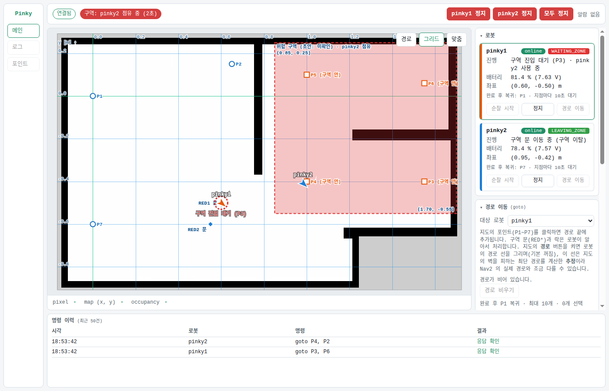
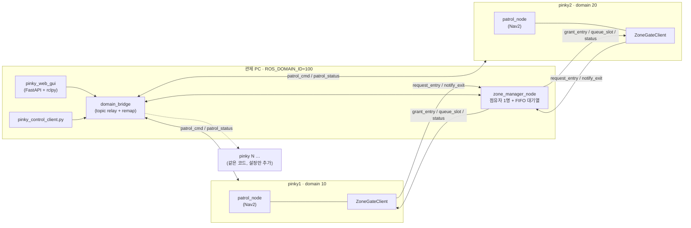

<h1 align="center">Pinky SLAM-NAV</h1>

<p align="center">
  <b>Multi-robot patrol &amp; zone-access control for ROS 2 / Nav2</b><br>
  한 번에 <b>한 대</b>만 위험구역에 들어가도록 로봇 여러 대를 관제하는 시스템
</p>

<p align="center">
  
  
  
  
  
</p>

<p align="center">
  
  <br><sub>관제 웹 GUI — 지도 위 로봇 위치, 구역 점유 상태(대기/이탈), 명령 이력</sub>
</p>

<!-- TODO: 토큰 발행/반납 데모를 10~15초 GIF로 만들어 docs/demo.gif 로 추가하고, 위 스크린샷 아래에  로 넣으세요. -->

---

## English summary

Two **Pinky** mobile robots patrol a small arena (≈1.9 × 1.15 m) with **Nav2**, and a **control PC** guarantees that only **one robot is inside the shared danger zone at a time**.

- **Zone mutual exclusion** — a `zone_manager` on the control PC grants entry to one robot, keeps a FIFO queue with per-slot waiting poses, and force-releases the zone on timeout. Robots only proceed while they hold a grant.
- **Scales by adding robots, not code** — every robot runs the same patrol code. Each robot lives in its own `ROS_DOMAIN_ID`; [`domain_bridge`](https://github.com/ros2/domain_bridge) relays only the needed topics to the control PC and remaps them to `/<robot>/...`.
- **Operator tooling** — CLI and web GUI (live map, battery, LiDAR overlay, e-stop, alarms, process start/stop, `--mock` mode that runs **without ROS or robots**).
- **Vision (optional)** — YOLO-based lane detection and a lane-following node (`pinky_camera`).
- **Network diagnostics** — scripts and a dashboard used to track down a multicast/DDS-discovery problem (see [Engineering notes](#engineering-notes)).

> Stack: ROS 2 Jazzy · Nav2 · Cyclone DDS · domain_bridge · Python (FastAPI, rclpy) · YOLO (Ultralytics) · chrony (NTP)

---

## 목차

- [한눈에 보기](#한눈에-보기)
- [시스템 구조](#시스템-구조)
- [빠른 시작 (로봇 없이 체험)](#빠른-시작-로봇-없이-체험)
- [Engineering notes](#engineering-notes)
- [주요 기능](#주요-기능) · [시스템 구성](#시스템-구성) · [설치 방법](#설치-방법) · [실행 방법](#실행-방법)
- [사용 예시](#사용-예시) · [환경변수](#환경변수) · [프로젝트 구조](#프로젝트-구조) · [기여 방법](#기여-방법) · [라이선스](#라이선스)

## 한눈에 보기

| 문제 | 접근 | 결과 |
|---|---|---|
| 좁은 맵에서 로봇 2대가 같은 구역을 공유 | 관제 PC의 `zone_manager`가 점유자 1명 + FIFO 대기열 관리 | 구역 안에는 항상 1대만 진입 |
| 로봇을 늘릴 때마다 코드 수정 | 동일 순찰 코드 + 로봇별 `ROS_DOMAIN_ID` + `domain_bridge` | 로봇과 브릿지 설정만 추가하면 N대로 확장 |
| 2대 연결 시 토픽이 랜덤하게 유실 | Cyclone DDS + 유니캐스트 Peer (멀티캐스트 discovery 제거) | 패킷 손실 5.3% → 0%, p95 RTT 135 → 18.8 ms |
| Nav2 Goal이 시작하자마자 Aborted | 관제 PC를 NTP 서버(chrony)로 두고 로봇을 클라이언트로 설정 | 관제 PC ↔ 로봇 시간 오차 약 0.0007 s |
| 좁은 맵(1.9×1.15 m)에서 U턴 실패 | 맵 해상도 1 cm/px, costmap `inflation_layer` 튜닝 (40시간+) | 부드러운 U턴, 목표 도달 오차 5 cm |

## 시스템 구조



구역 관리자의 상세 동작과 토픽은 [`zone_traffic_control/README.md`](zone_traffic_control/README.md), 전체 SVG 구성도는 [`docs/pinky_architecture_adaptive.svg`](docs/pinky_architecture_adaptive.svg)를 참고하세요.

## 빠른 시작 (로봇 없이 체험)

ROS 2 Jazzy가 설치된 Ubuntu 24.04에서, 로봇 없이 관제 웹 GUI를 가짜 로봇 2대로 띄웁니다.

```bash
git clone https://github.com/cdwlsgh1-source/pinky_slam_nav.git
cd pinky_slam_nav/pinky_web_gui

python3 -m venv --system-site-packages .venv
.venv/bin/pip install -r requirements.txt
.venv/bin/python -m backend.main --mock
```

브라우저에서 <http://localhost:8000/> 을 열고 `oper` / `oper`(보기 전용) 또는 `mngr` / `mngr`(명령 가능)으로 로그인합니다. 실제 로봇을 연결하려면 아래 [설치 방법](#설치-방법)과 [실행 방법](#실행-방법)을 따르세요.

## Engineering notes

실제 로봇 2대를 관제하며 겪은 문제와 해결 과정입니다.

### 1. 토픽 유실: 멀티캐스트 discovery 의존 제거

| | |
|---|---|
| 증상 | 로봇 2대를 연결하고 주행을 시작하는 순간 토픽이 랜덤하게 끊기고 복구되지 않음. 노드 디스커버리가 영구 붕괴 |
| 원인 (추정) | 공유기의 멀티캐스트(DDS discovery) 처리 불안정. 토픽이 늘수록 discovery 트래픽이 N²로 증가 |
| 시도 | ① AP 교체(5 GHz, Wi-Fi 6) → 부분 완화 ② RMW를 `rmw_cyclonedds_cpp`로 전환 → 개선 ③ `AllowMulticast=false` + 고정 IP를 Peer로 직접 지정 → **해결** |

| 측정 | FastDDS | Cyclone DDS |
|---|---|---|
| 패킷 손실 | 5.3 % | 0 % |
| p95 RTT | 135 ms | 18.8 ms |
| 노드 디스커버리 | 약 14분 후 0개로 붕괴 | 11.5분간 28개 유지 |

측정 조건: FastDDS 약 43.2분(2,408 ping), Cyclone DDS 약 13.9분(805 ping). 진단에 쓴 도구는 [`ros2_network_test/`](ros2_network_test/)에 있습니다.

### 2. 폐쇄망 시간 동기화

- **증상**: Nav2 Goal 주행을 시작하자마자 Feedback이 Aborted (토픽은 정상)
- **원인**: 인터넷이 끊긴 로봇의 시계가 관제 PC와 18일 어긋나, RViz2가 "시간이 맞지 않는 데이터"로 판단
- **해결**: 관제 PC에 chrony를 설치해 NTP 서버로 두고, 로봇이 관제 PC를 서버로 지정. `chronyc`로 확인한 오차 약 0.0007 s

### 3. 좁은 맵에서의 Nav2 튜닝

- 저장된 이미지를 확대하지 않고 **SLAM 실행 단계에서 해상도를 1 cm/px로 높임** (5 cm → 1 cm)
- 장애물 비용이 멀리까지 남으면 좁은 구간에서 U턴하지 못하고 멈춤 → `global_costmap.inflation_layer.cost_scaling_factor`를 1.0 → 8.0으로 올려 비용이 빠르게 감소하도록 조정 (`inflation_radius` 0.45 유지)
- 40시간 이상의 튜닝과 테스트로 안정적인 U턴과 정밀한 goal 도달 확보

### 4. 설계 원칙

- **로봇은 주행, PC는 관제**: 역할을 나눠 지연과 로봇 증가에 대비
- **동일한 주행 코드**: 로봇별 차이는 `robot_id`, 도메인, 브릿지 설정뿐
- **안전장치**: 점유자 이탈 통보 유실 시 `max_hold_sec` 강제 해제, 대기자 재요청이 끊기면 `queue_stale_sec` 후 큐에서 제거, 이동 실패 시 재시도 후 다음 좌표로 진행

**남은 과제**: 로봇 대수 확장 시 PC 부하와 통신 안정성 검증(Peer Star 전환 검토), Cyclone DDS 장시간 운용 시 CPU·메모리 추이 확인, 로봇 관제와 YOLO 통합.

---

## 주요 기능

- **원격 순찰 명령**: 관제 PC에서 `start` / `stop` / `goto` 명령을 보내고 `patrol_status`를 모니터링 (`pinky_patrol_cmd/`)
- **Nav2 순찰 노드**: 로봇에서 waypoint를 순서대로 순찰하고 진행 상태를 JSON으로 발행 (`my_pinky_package/`)
- **구역 상호 배제**: 위험 구역(P3~P6)에 한 대만 진입. v3는 FIFO 대기열과 대기 슬롯 좌표까지 관리 (`zone_traffic_control/`)
- **도메인 브릿지**: 관제 PC(도메인 100)와 로봇(pinky1=10, pinky2=20, pinky3=30) 사이에서 필요한 토픽만 중계하고 `/pinky1/...`, `/pinky2/...`, `/pinky3/...`로 remap (`domain_bridge/`)
- **관제 웹 GUI**: 지도 위 로봇 위치·배터리, 명령 패널, 비상정지, LiDAR 오버레이, 알람바, 프로세스 시작/정지. ROS 없이 확인하는 `--mock` 모드 지원 (`pinky_web_gui/`)
- **카메라 차선 추종**: CSI 카메라 영상 발행, YOLO 기반 차선 검출, 차선 추종 노드 (`pinky_camera/`)
- **지도 좌표 뷰어**와 **Wi-Fi 진단 스크립트** (`map_view_pc/`, `ros2_network_test/`)

## 시스템 구성

| 장비 | ROS_DOMAIN_ID | 실행하는 것 |
|---|---|---|
| 관제 PC | 100 | `domain_bridge`, `zone_manager_node`, 웹 GUI, `pinky_control_client.py` |
| pinky1 | 10 | Nav2, 순찰 노드, (카메라 사용 시) `camera_node`, `lane_detector_node` |
| pinky2 | 20 | Nav2, 순찰 노드 |
| pinky3 | 30 | Nav2, 순찰 노드 (`pinky_patrol_node_pinky3`, 홈 지점은 임시로 pinky2 와 동일) |

```
관제 PC(100) ──[domain_bridge]── pinky1(10)
     │        ├─[domain_bridge]── pinky2(20)
     │        └─[domain_bridge]── pinky3(30)
     ├─ /<robot>/patrol_cmd (start/stop/goto) ──▶ 로봇
     ├─ /<robot>/patrol_status ◀────────────────  로봇
     └─ /zone_manager/* (request_entry / grant_entry / notify_exit)
```


## 설치 방법

검증된 환경: Ubuntu 24.04, ROS 2 `jazzy`, Python 3.12 (관제 PC 기준).

**1. ROS 패키지 빌드** (관제 PC와 각 로봇에서 저장소 루트 기준)

```bash
git clone https://github.com/cdwlsgh1-source/pinky_slam_nav.git
cd pinky_slam_nav
source /opt/ros/jazzy/setup.bash

# 관제 PC
colcon build --packages-select domain_bridge zone_traffic_control
source install/setup.bash

# 로봇 (순찰 노드가 zone_gate_client를 import하므로 zone_traffic_control 필요)
colcon build --packages-select zone_traffic_control my_pinky_package
source install/setup.bash
```

- 로봇에는 Nav2(`nav2_simple_commander`)와 `pinky_interfaces`(`SetLed` 서비스)가 이미 설치되어 있어야 합니다. 이 저장소에는 포함되어 있지 않습니다.
- 카메라 패키지는 `colcon build --packages-select pinky_camera`로 빌드합니다. 로봇에는 `python3-picamera2`, `lane_detector_node`를 돌리는 쪽에는 pip 패키지 `ultralytics`가 필요합니다 (`package.xml` 주석).

**2. 웹 GUI 설치** (관제 PC, `pinky_web_gui/` 폴더에서 한 번만)

```bash
cd pinky_web_gui
python3 -m venv --system-site-packages .venv
.venv/bin/pip install -r requirements.txt
```

`rclpy`는 pip가 아니라 ROS 2가 제공하므로 venv를 `--system-site-packages`로 만듭니다.

## 실행 방법

아래 순서로 실행합니다 (`robot_id`는 `zone_traffic_control/config/zone_params.yaml`의 `robot_ids`와 같아야 합니다).

**1. 로봇**: 각 로봇에서 Nav2 bringup 실행

**2. 관제 PC — 도메인 브릿지** (한 대만 띄우려면 `pinky2:=false pinky3:=false`)

```bash
source /opt/ros/jazzy/setup.bash && source install/setup.bash
export ROS_DOMAIN_ID=100
ros2 launch domain_bridge bridges.launch.xml
```

**3. 관제 PC — zone_manager** (새 터미널)

```bash
source /opt/ros/jazzy/setup.bash && source install/setup.bash
export ROS_DOMAIN_ID=100
ros2 launch zone_traffic_control zone_manager.launch.xml
```

**4. 로봇 — 순찰 노드** (각 로봇에서)

```bash
# pinky1 (도메인 10)
ros2 run my_pinky_package pinky_patrol_node_pinky1 --ros-args -p robot_id:=pinky1

# pinky2 (도메인 20)
ros2 run my_pinky_package pinky_patrol_node_pinky2 --ros-args -p robot_id:=pinky2
```

**5. 관제 PC — 명령 또는 웹 GUI**

```bash
source /opt/ros/jazzy/setup.bash
export ROS_DOMAIN_ID=100
python3 pinky_patrol_cmd/pinky_control_client.py pinky1 monitor
```

### 웹 GUI

```bash
cd pinky_web_gui

# ROS 없이 (가짜 로봇 2대)
.venv/bin/python -m backend.main --mock

# 실제 로봇 연결 (브릿지가 먼저 떠 있어야 함)
source /opt/ros/jazzy/setup.bash
export ROS_DOMAIN_ID=100
.venv/bin/python -m backend.main
```

브라우저에서 <http://localhost:8000/> 을 열고 로그인합니다. 계정은 `backend/auth.py`에 고정되어 있습니다 (`mngr`/`mngr`: 명령 가능, `oper`/`oper`: 보기 전용). 신뢰하는 내부망에서만 사용하세요.

| 옵션 | 기본값 | 설명 |
|---|---|---|
| `--mock` | 꺼짐 | ROS 없이 가짜 데이터로 실행 |
| `--host` | `127.0.0.1` | 다른 PC에서 접속하려면 `0.0.0.0` |
| `--port` | `8000` | 포트 |
| `--config` | `config/robots.yaml` | 설정 파일 경로 |
| `--no-auth` | 꺼짐 | 로그인 끔 (개발용, 프로세스 제어도 꺼짐) |

전체 옵션은 `.venv/bin/python -m backend.main --help` 또는 [`pinky_web_gui/docs/usage.md`](pinky_web_gui/docs/usage.md)를 참고하세요.

### 대기열 구성

RED POINT(RED*) 대신 앵커/대기슬롯을 씁니다. 이전 세대(RED* 문 방식)는 git 태그 `v2-final` 에 보존되어 있습니다.

```bash
# 관제 PC
ros2 launch zone_traffic_control zone_manager.launch.xml

# 로봇
ros2 run my_pinky_package pinky_patrol_node_pinky1 --ros-args -p robot_id:=pinky1
ros2 run my_pinky_package pinky_patrol_node_pinky2 --ros-args -p robot_id:=pinky2
```

### 카메라 / 차선 추종 (선택)

```bash
# 로봇: 카메라와 차선 검출 (namespace는 pinky1 | pinky2)
ros2 launch pinky_camera camera.launch.xml namespace:=pinky1
ros2 launch pinky_camera lane_detector.launch.xml namespace:=pinky1

# 관제 PC: 차선 추종 (브릿지 설정상 관제 PC에서 실행)
ros2 launch pinky_camera lane_follower.launch.xml namespace:=pinky1
```

> `config/lane_detector_params.yaml`의 `model_path`가 `/home/jinho/dev_ws/best.pt`로 하드코딩되어 있습니다. 실행 전에 실제 경로(저장소의 `pinky_camera/lane_seg_best.pt` 등)로 바꾸세요. 어느 모델이 최종인지는 **[TODO]**.

### 지도 뷰어 / 네트워크 진단

```bash
# 지도 좌표 뷰어: 브라우저로 열기 (서버 불필요)
xdg-open map_view_pc/pinky_map_viewer.html

# 네트워크 진단 (관제 PC): <핑키IP> [부하_Hz] [지속시간_분] [인터페이스] [감시_토픽]
# 인터페이스를 생략하면 무선 인터페이스를 자동 감지합니다.
cd ros2_network_test
chmod +x ros2_net_diag.sh
./ros2_net_diag.sh 192.168.0.101 0.1 30 wlan0 "/scan,/tf,/map,/odom"

# 이상 이력 대시보드 (다른 터미널, ros2_network_test 폴더에서): http://localhost:8088/
python3 net_monitor.py
```

진단 스크립트는 핑·처리량·WiFi·토픽 대역폭과 함께 UDP/TCP/멀티캐스트/유니캐스트 부하(`proto_load.csv`)를 기록하고, `net_monitor.py`는 그 로그에서 이상 시점을 찾아 보여줍니다. 임계값은 `net_monitor.json`, 자세한 내용은 [`ros2_network_test/README.md`](ros2_network_test/README.md)를 참고하세요. 시험할 때는 실제 관제 도메인(100)과 섞이지 않도록 `ROS_DOMAIN_ID=77`, `ROS_LOCALHOST_ONLY=1`을 쓰세요.

## 사용 예시

**순찰 명령 (관제 PC)**

```bash
python3 pinky_patrol_cmd/pinky_control_client.py <pinky1|pinky2> <start|stop|monitor|goto 포인트...>

python3 pinky_patrol_cmd/pinky_control_client.py pinky1 start          # 순찰 시작
python3 pinky_patrol_cmd/pinky_control_client.py pinky1 goto P2 P3 P6  # 지정 지점 순서대로 이동 (내부적으로 goto:P2,P3,P6)
python3 pinky_patrol_cmd/pinky_control_client.py pinky1 monitor        # 상태 출력 (Ctrl+C로 종료)
python3 pinky_patrol_cmd/pinky_control_client.py pinky1 stop           # 순찰 중지
```

**구역 점유 상태 확인**

```bash
ros2 topic echo /zone_manager/status    # free | occupied_by:pinky1
```

**웹 GUI REST API (`--mock` 서버를 띄운 상태)**

```bash
curl -s localhost:8000/api/health

curl -s -c /tmp/pinky.cookie -X POST localhost:8000/api/login \
  -H 'Content-Type: application/json' -d '{"id": "mngr", "password": "mngr"}'
curl -s -b /tmp/pinky.cookie -X POST localhost:8000/api/robots/pinky1/command \
  -H 'Content-Type: application/json' -d '{"cmd": "goto", "points": ["P2", "P3", "P6"]}'
```

**웹 GUI 테스트 (ROS 불필요)**

```bash
cd pinky_web_gui && .venv/bin/python -m pytest tests -q
```

## 환경변수

| 변수 | 값 | 사용처 | 설명 |
|---|---|---|---|
| `ROS_DOMAIN_ID` | 관제 PC `100`, pinky1 `10`, pinky2 `20`, pinky3 `30` | 전체 | 장비별 ROS 도메인. 웹 GUI는 100이 아니면 시작 시 경고 |
| `ROS_LOCALHOST_ONLY` | 설정하지 않음 | 웹 GUI | `1`이면 브릿지 토픽을 못 받는다는 경고 |
| `RMW_IMPLEMENTATION` | `rmw_cyclonedds_cpp` | 로봇 | `processes.yaml`의 `env`로 SSH 실행 시 주입. PC의 CycloneDDS와 맞춰야 함 |
| `CYCLONEDDS_URI` | `file:///home/pinky/.ros/cyclonedds_robot.xml` | 로봇 | 위와 같음. 로봇 터미널 값과 같게 둠 |
| `ROS_AUTOMATIC_DISCOVERY_RANGE` | `SUBNET` | 로봇 | 위와 같음 |
| `ssh.password_env`가 가리키는 변수 | 선택 | 웹 GUI | `processes.yaml` 항목에 변수 **이름**을 적으면 SSH 비밀번호로 사용 (`sshpass` 필요). 기본은 SSH 키 로그인 |
| `ROS_DOMAIN_ID=77` + `ROS_LOCALHOST_ONLY=1` | 시험용 | 테스트 | ROS 경로 검증 테스트 전용 격리 값 (`verify_step4_ros.py`, zone/patrol 테스트) |
| `STEP4_SERVER_LOG` | 파일 경로, 선택 | 테스트 | `verify_step4_ros.py` 디버깅용 서버 로그 파일 |

> ROS 파라미터 `robot_id`(순찰 노드, `-p robot_id:=pinky1`)는 환경변수가 아닙니다. 웹 GUI의 나머지 설정은 `pinky_web_gui/config/*.yaml`에 있습니다.

## 프로젝트 구조

```
pinky_slam_nav/
├── domain_bridge/          # ros2/domain_bridge 소스 + 직접 작성한 launch/config
│   ├── config/             #   pinky_bridge_pinky{1,2,3}.yaml
│   └── launch/             #   bridges.launch.xml (로봇별 브릿지 실행)
├── my_pinky_package/       # 로봇용 순찰 노드 (pinky_patrol_node_pinky{1,2,3})
├── pinky_patrol_cmd/       # 관제 PC용 CLI (pinky_control_client.py)
├── zone_traffic_control/   # 구역 상호 배제 (zone_manager_node, zone_gate_client)
├── pinky_camera/           # camera_node, lane_detector_node, lane_follower_node, YOLO 모델(.pt)
├── pinky_web_gui/          # 관제 웹 GUI
│   ├── backend/            #   FastAPI + rclpy, 인증, 알람, 프로세스 제어, mock
│   ├── frontend/           #   정적 화면 (빌드 없음)
│   ├── config/             #   robots.yaml, processes.yaml, points.yaml, zone.yaml, alarms.yaml
│   ├── docs/               #   usage.md, interfaces.md, 체크리스트, PRD
│   └── tests/              #   pytest, verify_*.py
├── map_view_pc/            # 지도(my_pinky_map10.yaml/.pgm), 좌표 뷰어 HTML
└── ros2_network_test/      # 네트워크 진단 스크립트(ros2_net_diag.sh)와 이상 이력 대시보드(net_monitor.py)
```

## 기여 방법

저장소 이력에서 확인되는 관례입니다. 별도의 기여 가이드 문서는 없으며, 그 밖의 규칙은 **[TODO]**.

1. `main`에서 기능 브랜치를 만듭니다 (예: `feature/patrol-v1.4.0`, `refactor/drop-version-suffix`).
2. 커밋 메시지는 `패키지명: 변경 내용` 형식의 한국어 한 줄로 씁니다 (예: `my_pinky_package: v1.4.0 S1 파라미터 레이어 추가 (pinky1)`).
3. 변경한 부분의 테스트를 실행합니다. 웹 GUI는 ROS 없이 돌아갑니다.
   ```bash
   cd pinky_web_gui && .venv/bin/python -m pytest tests -q
   ```
   ROS 경로를 검증할 때는 실제 도메인을 건드리지 않도록 `ROS_DOMAIN_ID=77`과 `ROS_LOCALHOST_ONLY=1`로 격리해서 실행하세요.
4. GitHub에서 Pull Request를 열어 `main`에 병합합니다.

`domain_bridge/`는 [ros2/domain_bridge](https://github.com/ros2/domain_bridge) 소스를 포함하므로, 이 폴더의 기여 규칙은 `domain_bridge/CONTRIBUTING.md`를 따릅니다.

## 라이선스

저장소 루트에는 `LICENSE` 파일이 없어 전체 라이선스는 **[TODO]** 입니다. 패키지별 `package.xml` 선언은 다음과 같습니다.

| 패키지 | 라이선스 |
|---|---|
| `domain_bridge` | Apache 2.0 (`domain_bridge/LICENSE` 포함) |
| `zone_traffic_control` | Apache-2.0 |
| `pinky_camera` | Apache-2.0 |
| `my_pinky_package` | **[TODO]** (`package.xml`에 `TODO: License declaration`로 남아 있음) |
| `pinky_web_gui`, `pinky_patrol_cmd`, `map_view_pc`, `ros2_network_test` | **[TODO]** (선언 없음) |
