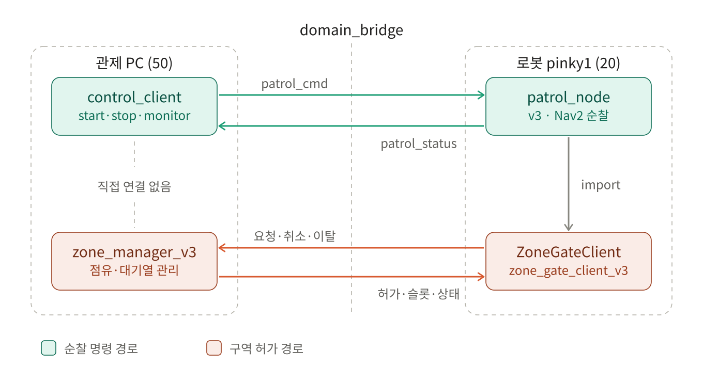

# zone_traffic_control

여러 대의 Pinky 로봇이 위험구역(zone)에 **한 번에 한 대만** 들어가도록 허가·대기열 슬롯을 관리하는 ROS 2 패키지 (v3 기준).

> 이 문서는 **v3** 만 다룹니다. `zone_manager_node.py`, `zone_manager_node_v2.py`, `zone_gate_client.py`, `zone_gate_client_v2.py` 는 구버전이며 새 구성에서는 사용하지 않습니다.

## 구조도



핵심 실행 코드는 3개입니다.

| 구성요소 | 파일 | 실행 위치 | 역할 |
|---|---|---|---|
| 구역 관리자 | `zone_traffic_control/zone_manager_node_v3.py` | 관제 PC (1대만) | 점유자 1명 + FIFO 대기열 관리, 허가·슬롯 좌표 발행 |
| 로봇용 클라이언트 | `zone_traffic_control/zone_gate_client_v3.py` | 각 로봇 (patrol 노드가 import) | 진입 요청/재전송/취소/이탈 통보, 허가·슬롯 수신 |
| 제어 클라이언트 | `pinky_control_client_v3.py` | 관제 PC | start·stop·monitor 명령 전송 — **[TODO] 저장소에서 이 파일을 찾지 못함** (아래 참고) |

```
관제 PC (ROS_DOMAIN_ID=50)                      로봇 pinky1 (도메인 20)
  control_client ──patrol_cmd──▶ domain_bridge ──▶ patrol_node(v3, Nav2 순찰)
                 ◀─patrol_status─                         │ import
  zone_manager_v3 ◀──────── request_entry / cancel_entry / notify_exit ── ZoneGateClient
                  ────────▶ grant_entry / queue_slot / status ─────────▶ (zone_gate_client_v3)
```

> `pinky_control_client_v3.py` 는 `find` 로 검색해도 없었고, 비슷한 파일은 `../pinky_patrol_cmd/pinky_control_client_v2.py` 하나뿐입니다. v3 파일의 위치/이름은 **[TODO]** 로 남깁니다. (zone 토픽은 직접 사용하지 않고 `/<robot>/patrol_cmd`, `/<robot>/patrol_status` 만 사용하는 것으로 확인됨)

## 주요 기능

- **상호 배제**: 구역이 비어 있으면 즉시 `grant_entry`, 점유 중이면 FIFO 대기열에 등록
- **대기열 슬롯 좌표 지정**: 대기 순번 `k` 에 대해 `슬롯 k = 앵커 + k × 간격 × 후방벡터` 를 계산해 `queue_slot` 으로 로봇에 전달 (map 좌표계 x, y, yaw)
- **전진 지연**: 앞 로봇이 앵커를 떠날 시간을 준 뒤(`queue_advance_delay_sec`) 뒤 로봇을 한 칸씩 전진 — 충돌 방지
- **대기열 상한**: `queue_max` 초과 시 `k=-1` 로 거부 (로봇은 진입 포기)
- **안전장치**
  - `max_hold_sec`: 점유자가 `notify_exit` 를 못 보내도 강제 해제
  - `queue_stale_sec`: `request_entry` 재전송(1초 주기)이 끊긴 대기자를 큐에서 제거
  - 점유자가 아닌 로봇의 `notify_exit` 는 무시
- **유실 대비**: 1초마다 `status` 와 이미 알려준 슬롯을 재발행
- 토픽 이름공간이 `/zone_manager_v3/*` 라 v1/v2 매니저와 동시에 켜도 섞이지 않음

## 설치 방법

의존성은 `rclpy`, `std_msgs`, `launch`, `launch_ros` 입니다 (`package.xml`). Nav2 는 로봇 쪽 patrol 노드에서만 필요합니다.

ROS 2 배포판은 **[TODO]** (기존 문서에 Jazzy 가 예시로만 언급됨, 확정 아님). 아래에서 `<ROS_DISTRO>` 를 실제 설치 값으로 바꾸세요.

```bash
source /opt/ros/<ROS_DISTRO>/setup.bash
cd ~/dev_ws/pinky_slam_nav
rosdep install --from-paths zone_traffic_control --ignore-src -r -y
colcon build --packages-select zone_traffic_control
source install/setup.bash
```

관제 PC 와 각 로봇 모두에 같은 방식으로 설치합니다 (로봇의 patrol 노드가 `zone_gate_client_v3` 를 import 하기 때문).

## 실행 방법

### 1. 관제 PC: zone_manager_node_v3

```bash
ros2 launch zone_traffic_control zone_manager_v3.launch.xml
```

`config/zone_params_v3.yaml` 의 `robot_ids` 는 로봇 patrol 노드의 `robot_id` 파라미터와 정확히 같아야 합니다.

### 2. 도메인 브릿지

zone 토픽 6개를 로봇 도메인 ↔ 관제 도메인 사이에서 브릿지해야 합니다. 브릿지 설정 파일은 **[TODO]** (이 저장소에서 v3 용 설정을 확인하지 못함).

- `/zone_manager_v3/request_entry`, `/zone_manager_v3/notify_exit`, `/zone_manager_v3/cancel_entry` (로봇 → 매니저)
- `/zone_manager_v3/grant_entry`, `/zone_manager_v3/queue_slot`, `/zone_manager_v3/status` (매니저 → 로봇)

### 3. 로봇: patrol 노드 (zone_gate_client_v3 사용)

`my_pinky_package/setup.py` 에 등록된 엔트리포인트 기준:

```bash
ros2 run my_pinky_package pinky_patrol_node_pinky1_v3 --ros-args -p robot_id:=pinky1
ros2 run my_pinky_package pinky_patrol_node_pinky2_v3 --ros-args -p robot_id:=pinky2
```

(각각 해당 로봇에서 실행. 네임스페이스/도메인 설정은 **[TODO]**)

### 4. 관제 PC: 순찰 명령

`pinky_control_client_v3.py` 를 찾지 못해 v2 기준으로 적습니다. v3 의 정확한 실행 경로는 **[TODO]**.

```bash
python3 ~/dev_ws/pinky_slam_nav/pinky_patrol_cmd/pinky_control_client_v2.py pinky1 start
```

## 사용 예시

```bash
# 구역 점유 상태 확인 ("free" 또는 "occupied_by:<robot_id>")
ros2 topic echo /zone_manager_v3/status

# 허가 / 슬롯 흐름 보기
ros2 topic echo /zone_manager_v3/grant_entry
ros2 topic echo /zone_manager_v3/queue_slot

# 순찰 시작 / 정지 / 상태 모니터 (v2 클라이언트 기준)
python3 ~/dev_ws/pinky_slam_nav/pinky_patrol_cmd/pinky_control_client_v2.py pinky1 start
python3 ~/dev_ws/pinky_slam_nav/pinky_patrol_cmd/pinky_control_client_v2.py pinky2 goto P2 P3 P6
python3 ~/dev_ws/pinky_slam_nav/pinky_patrol_cmd/pinky_control_client_v2.py pinky1 monitor
python3 ~/dev_ws/pinky_slam_nav/pinky_patrol_cmd/pinky_control_client_v2.py pinky1 stop
```

메시지 형식 (모두 `std_msgs/String`):

| 토픽 | 방향 | 형식 |
|---|---|---|
| `request_entry` | 로봇 → 매니저 | `<robot_id>:<token>` (1초마다 재전송) |
| `notify_exit` | 로봇 → 매니저 | `<robot_id>` |
| `cancel_entry` | 로봇 → 매니저 | `<robot_id>` |
| `grant_entry` | 매니저 → 로봇 | `<robot_id>:<token>` |
| `queue_slot` | 매니저 → 로봇 | `<robot_id>:<k>:<x>,<y>,<yaw>` (`k=-1` 이면 대기열 가득) |
| `status` | 매니저 → 모니터링 | `free` / `occupied_by:<robot_id>` |

로봇 코드에서 사용하는 예 (`zone_gate_client_v3.ZoneGateClient`):

```python
gate = ZoneGateClient(node, robot_id='pinky1')
gate.reset()
token = gate.send_request()
while not gate.granted(token):
    gate.resend_if_due()          # 1초마다 재전송 (끊기면 stale 로 제거됨)
    # gate.current_slot -> (k, x, y, yaw), gate.queue_full -> 대기열 가득 여부
gate.notify_exit()                # 구역을 나오면 락 반납
```

## 환경변수 표

이 패키지 코드가 직접 읽는 환경변수는 없습니다 (`os.environ` 미사용). 아래는 ROS 2 가 읽는 값입니다.

| 이름 | 설명 | 값 |
|---|---|---|
| `ROS_DOMAIN_ID` | ROS 2 도메인 | 구조도 기준 관제 PC 50, pinky1 20 (pinky2 는 **[TODO]**) |

### ROS 파라미터 (`config/zone_params_v3.yaml`, 노드 `zone_manager_node_v3`)

| 파라미터 | yaml 값 | 코드 기본값 | 설명 |
|---|---|---|---|
| `robot_ids` | `["pinky1", "pinky2"]` | 동일 | patrol 노드의 `robot_id` 와 일치해야 함 |
| `max_hold_sec` | `120.0` | `120.0` | 점유 강제 해제 시간(초) |
| `queue_anchor` | `[1.0, -0.7, 0.0]` | `[0.0, 0.0, 0.0]` | 슬롯 0 위치 `[x, y, yaw]` (map). patrol 노드의 `ZONE_ENTRY` 와 같아야 함 |
| `queue_back_dir` | `[-1.0, 0.0]` | `[-1.0, 0.0]` | 줄이 늘어나는 방향 (자동 정규화) |
| `queue_spacing` | `0.30` | `0.30` | 슬롯 간격(m) |
| `queue_max` | `3` | `3` | 최대 대기자 수 |
| `queue_stale_sec` | `5.0` | `5.0` | 재전송 끊김 판정 시간(초) |
| `queue_advance_delay_sec` | `3.0` | `3.0` | 뒤 로봇 전진 지연(초) |

> 주의: yaml 주석에는 "간격 0.50 m" 라고 적혀 있지만 실제 값은 `queue_spacing: 0.30` 입니다. 어느 쪽이 의도인지 **[TODO]** (수정 필요).

## 프로젝트 구조

```
zone_traffic_control/
├── config/
│   ├── zone_params_v3.yaml        # v3 파라미터 (사용)
│   └── zone_params.yaml, zone_params_v2.yaml   # 구버전
├── docs/
│   └── zone_v3_relationship_light.svg          # 구조도
├── launch/
│   ├── zone_manager_v3.launch.xml # v3 실행 (사용)
│   └── zone_manager.launch.xml, zone_manager_v2.launch.xml   # 구버전
├── test/
│   ├── test_zone_manager_v3.py    # slot_pose / normalize_dir / ZoneQueue
│   └── test_zone_gate_client_v3.py
├── zone_traffic_control/
│   ├── zone_manager_node_v3.py    # [핵심] 구역 관리자 노드
│   ├── zone_gate_client_v3.py     # [핵심] 로봇용 클라이언트
│   ├── README.md                  # 구버전(v1) 코드 해설
│   └── zone_manager_node*.py, zone_gate_client*.py   # 구버전 (v1, v2)
├── package.xml / setup.py / setup.cfg
└── resource/zone_traffic_control
```

`zone_manager_node_v3.py` 는 ROS 와 무관한 순수 로직(`normalize_dir`, `slot_pose`, `ZoneQueue`)과 ROS 노드(`ZoneManagerNodeV3`)로 나뉘어 있어 단위 테스트가 가능합니다.

테스트 (ROS 환경을 source 한 뒤, 이 패키지 디렉터리에서; 이 문서 작성 시 실행해 확인하지는 않았음):

```bash
cd ~/dev_ws/pinky_slam_nav/zone_traffic_control
python3 -m pytest test/test_zone_manager_v3.py test/test_zone_gate_client_v3.py
```

> 테스트 시 셸 기본 도메인 50 은 실제 관제 도메인이므로, ROS 통신이 필요한 검증은 `ROS_DOMAIN_ID=77` 과 `ROS_LOCALHOST_ONLY=1` 로 격리해서 하세요. (위 단위 테스트는 노드를 띄우지 않음)

